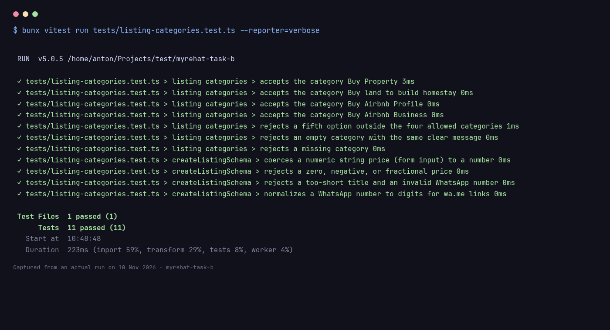

# Homework 1 — Validasi kategori listing

Permintaan: di luar 4 kategori resmi harus ditolak dengan pesan yang jelas, plus
screenshot vitest hijau yang memuat case reject opsi ke-5.

## Kategori resmi (satu sumber)

`packages/db/src/categories.ts`:

```ts
export const LISTING_CATEGORIES = [
  "Buy Property",
  "Buy land to build homestay",
  "Buy Airbnb Profile",
  "Buy Airbnb Business",
] as const;
```

Konstanta ini dipakai di tiga lapisan sekaligus:

| Lapisan | File | Perilaku |
| --- | --- | --- |
| Enum PostgreSQL | `packages/db/src/schema/listing.ts` | `pgEnum("listing_category", LISTING_CATEGORIES)` |
| Validasi API | `packages/api/src/schemas/listing.ts` | `z.enum(LISTING_CATEGORIES, { error: ... })` |
| Dropdown UI | `apps/web/src/components/listing-form.tsx` | hanya merender 4 opsi |

Pesan errornya:

```
Category must be one of: Buy Property, Buy land to build homestay, Buy Airbnb Profile, Buy Airbnb Business
```

## Bukti unit test

Command:

```bash
bunx vitest run tests/listing-categories.test.ts --reporter=verbose
```

Hasil: **11 passed (11)**, termasuk:

```
✓ rejects a fifth option outside the four allowed categories
✓ rejects an empty category with the same clear message
```

Test ini tidak cuma memastikan `success === false`; ia juga memastikan pesan
diawali `Category must be one of:` dan menyebut keempat opsi resmi.



## Bukti HTTP (validasi tidak bisa dilewati dari UI)

Signup untuk mendapat cookie session, lalu panggil endpoint listing langsung.

**Opsi ke-5 (`Rent Property`) ditolak:**

```bash
curl -b cj.txt -X POST http://localhost:3001/rpc/listings/create \
  -H 'content-type: application/json' \
  -d '{"json":{"title":"Homestay near Tanah Rata","price":450000,"location":"Cameron Highlands","category":"Rent Property","whatsapp":"+60 12-345 6789"}}'
```

Respons: **HTTP 400**

```json
{
  "json": {
    "defined": false,
    "code": "BAD_REQUEST",
    "status": 400,
    "message": "Input validation failed",
    "data": {
      "issues": [
        {
          "code": "invalid_value",
          "values": [
            "Buy Property",
            "Buy land to build homestay",
            "Buy Airbnb Profile",
            "Buy Airbnb Business"
          ],
          "path": ["category"],
          "message": "Category must be one of: Buy Property, Buy land to build homestay, Buy Airbnb Profile, Buy Airbnb Business"
        }
      ]
    }
  }
}
```

**Kategori resmi (`Buy Property`) diterima:**

Respons: **HTTP 200**, row tersimpan dengan `"category":"Buy Property"`.

## UI juga menampilkan pesan server

`apps/web/src/components/listing-form.tsx` sekarang mengambil `issues[0].message`
dari respons server. Jadi kalau validasi client dilewati, pengguna tetap melihat
pesan kategori yang jelas — bukan hanya `"Input validation failed"`.
